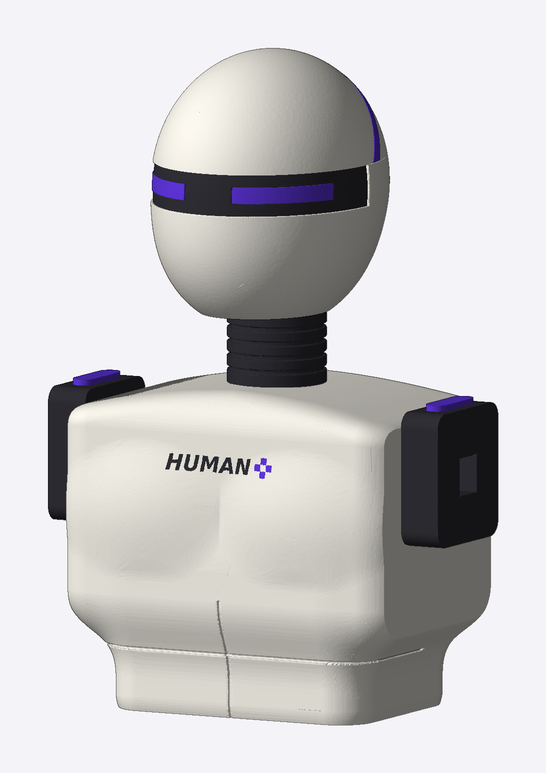

# HUMAN+ · Unitree G1 1:1 全打印静态摆件

把 MakerWorld 的 [Unitree G1 静态模型](https://makerworld.com/models/2512182)（`G1Static.stl`）
等比放大到真机身高，拆成能上机的零件，按 HUMAN+ 配色分件：白色外壳、炭黑关节、紫色点缀。
**头部换成自己设计的“光环头”**：亮黑头芯、白色甲片、一道紫色目线、脑后一圈紫色光环（不是 G1 原头）。
**纯 3D 打印、不会动**：没有电机、螺丝或金属件，零件之间用打印的方榫条连接。


| | |
|---|---|
| 头顶高度 | 1320 mm（宇树官方站立身高）；光环顶 1337 mm；举起的右手指尖 1551 mm |
| 宽 × 厚 | 498 × 377 mm（含两臂姿态） |
| 底座 | 440 × 420 × 30 mm，四拼 |
| 文件 / 件数 | 60 个 STL，共 72 件 |
| 耗材（切片结果，PETG，含支撑） | 白 ≈ 6.8 kg · 黑 ≈ 2.7 kg（含连接件、支撑柱）· 紫 ≈ 0.3 kg，合计约 9.9 kg |
| 胸口 logo 位 | 112 × 24 mm 平底浅槽，贴纸建议 108 × 20 mm |
| 重心 | 离底座顶面约 743 mm，落在底座中心，倾倒角约 15° |

> **请先知悉**
> - 文件只做过软件检查（见下方“已校验”），**没有实物试打**。请先打
>   `stl/4_connectors/fit_test_coupon.stl` 试榫条松紧，再开大件。
> - 黑色、紫色件与白色外壳的分界是**按平面切出来的近似边界**（源模型是一整块，没有按零件分块），
>   位置对照模型上的分缝线选定，和真机不完全一致。
> - 脚踝最细处内切半径只有约 10 mm，撑不住约 7 kg 的上身，所以**加了一根背后黑色支撑柱**
>   （底座 → 骨盆后侧）。脚掌和脚踝做成一体，不在最细处拆件。
> - 配色取自 HUMAN+ 效果图的色卡：白 `#ECE9E0`、炭黑 `#2E2E34`、紫 `#5C34D6`。紫色用在上臂段、腕环、目线和光环；
>   黑色用在头芯、颈、腰柱、肘环、膝、脚和支撑柱。渲染图把黑色画成亮面，实物要用亮面黑 PETG 或后期喷亮光漆才有这个效果。耗材颜色以实物色卡为准。
> - 源模型是 Standard Digital File License：只能自用，**不能转发文件**，所以本仓库必须保持私有。

## 目录

```
stl/1_white/          白色 23 件：身体外壳 15 件、头部甲片 3 件、骨盆、底座 4 块
stl/2_black/          黑色 14 件：头芯、光环支杆 2、脚 2、膝 2、颈环、腰柱、肘环 2、支撑柱 3 段
stl/3_purple/         紫色 6 件：上臂段 2、腕环 2、目线、光环
stl/4_connectors/     榫条 24 根（15 种规格）、底座蝴蝶键 4 个、试配件 1 个
docs/parts.csv        每个文件的尺寸 / 体积 / 数量 / 适用机器 / 用途
docs/summary.json     总体数据与每处榫条规格
docs/slice_report.json 每组切片的盘数 / 时长 / 克数
docs/preview_*.png    预览图与爆炸图
generator/            生成全部文件的脚本
source/g1/            源模型（zip 切成三段，生成脚本会自动拼接解压）
```

所有 STL 都已摆成**打印姿态**（贴床面朝下、居中），导入切片软件后不要再旋转。

## 机器适配

- **A2L**：只有 `torso.stl`（231 × 163 × 315 mm）必须用它。
- **A1 ×2、X2D**：其余 59 个文件都放得进 256 mm 机器（已留 6 mm 边）。

## 打印建议

全部用 **PETG**（密度比 PLA 略高，耗材估算再加约 3%）。

| 零件 | 颜色 | 参数 |
|---|---|---|
| 白色外壳、骨盆 | PETG 白 | 0.2 mm 层高，3 层壁，10–15% 填充；需要支撑的：`head_cap_*`、`head_cheek`、`hand_*`、`torso`、`hip_*`；`pelvis` 侧躺打印 |
| 黑色关节件 | PETG 黑 | 3 层壁，15% 填充 |
| 紫色件 | PETG 紫（接近 `#5C34D6`） | 3 层壁，15% 填充 |
| `foot_L` / `foot_R` | PETG 黑 | **8 层壁 + 40% 填充**（脚踝最细处基本全是壁；100% 填充要多用约 0.8 kg） |
| `waistcol` | PETG 黑 | 6 层壁，40% 填充（腰柱承上身重量） |
| `head`（头芯） | PETG 黑（亮面） | 颈座朝下，需支撑，3 层壁，15% 填充 |
| `halo`（光环）、`head_eye`（目线） | PETG 紫 | 光环削平的背面贴床，加 brim；目线平放 |
| `halo_strut_L/R` | PETG 黑 | 平躺，和脚同一组参数（8 层壁，实际是实心） |
| 榫条、蝴蝶键、`post_*` | PETG，颜色随意 | 平躺，4 层壁，40% 填充 |
| 底座 4 块 | PETG 白 | 顶面朝上，3 层壁，15% 填充 |

PETG 注意：先烘干；榫孔间隙 0.2 mm 是按 PLA 定的，PETG 容易偏紧，**一定先打试配件**，
偏紧就把 `generator/g1_build.py` 里的 `CLR` 调到 0.25–0.3 重新生成；支撑面留 0.2–0.25 mm 间隙，否则难拆。

## 切片与机器排产

`generator/slice.py` 用 Bambu Studio 02.09.01.70 的命令行，按机器和参数把零件分成 12 组切好（官方预设：0.4 喷嘴、0.20mm Standard、Bambu PETG HF、纹理 PEI 板）。
切好的 `.gcode.3mf` 每个几十 MB，不进仓库；重新切：`python3 generator/slice.py --out <目录>`。每组的盘数、时长、克数见 `docs/slice_report.json`。

| 机器 | 文件 | 内容 | 盘数 | 时长 | 耗材 |
|---|---|---|---|---|---|
| X2D | `x2d_01_先打_试配件` | 试配件 + T16、T24 榫条各一根 | 1 | 1.3 h | 61 g |
| X2D | `x2d_02_连接件和支撑柱` | 全部榫条、蝴蝶键、支撑柱 3 段（黑） | 2 | 17.2 h | 966 g |
| X2D | `x2d_03_黑_脚和支杆_加强` | 两只脚、光环支杆 | 1 | 17.3 h | 762 g |
| X2D | `x2d_04_黑_腰柱` | 腰柱 | 1 | 3.7 h | 145 g |
| X2D | `x2d_05_黑_头芯和关节` | 头芯、膝 2、颈环、肘环 2 | 3 | 17.6 h | 828 g |
| X2D | `x2d_06_紫_上臂腕环目线` | 上臂段 2、腕环 2、目线 | 1 | 7.3 h | 276 g |
| X2D | `x2d_07_紫_光环` | 光环 | 1 | 0.7 h | 17 g |
| A2L | `a2l_01_白_躯干` | 躯干 | 1 | 40.8 h | 1879 g |
| A2L | `a2l_02_白_骨盆` | 骨盆 | 1 | 11.9 h | 495 g |
| A1 | `a1_01_白_底座` | 底座 4 块 | 4 | 23.3 h | 1430 g |
| A1 | `a1_02_白_腿` | 小腿 2、大腿 2 | 2 | 36.2 h | 1544 g |
| A1 | `a1_03_白_上身和头甲` | 髋、肩、肘、手、前臂、头部甲片 | 5 | 45.4 h | 1495 g |

合计 23 盘：X2D 约 65 h，A2L 约 53 h，两台 A1 共约 105 h（各约 52 h）。A1 的三个文件两台通用，按盘分给两台即可。
用的是 Bambu PETG HF 预设；换别的 PETG 要在切片软件里改耗材后重切。**先打 `x2d_01` 试松紧，再开其它。**

## 光环头



- `head`：亮黑头芯，和颈座一体，表面留了甲片座槽、目线槽和两个支杆孔。
- `head_cap_f` / `head_cap_r` / `head_cheek`：白色甲片，厚约 6 mm，扣进座槽后比黑色脸面高出约 3 mm；前后顶甲之间留 3 mm 缝。
- `head_eye`：80 × 6 mm 紫色目线，从正面压进槽里。
- `halo`：直径约 156 mm 的紫色圆环，向后仰 18°，下端贴着头壳断开；左右各一个节点。
- `halo_strut_L/R`：5 × 5 × 40 mm 黑色支杆，一头插进头芯约 10 mm，一头插进光环节点。光环很轻（约 16 g），只靠这两根杆和下端两处点胶固定，搬动时别提光环。

## Logo 贴纸位

- 位置：胸口正中偏上（原模型 UNITREE 浮雕字的位置，已被这块槽盖掉），槽中心离地 1050 mm。
- 形状：112 × 24 mm 圆角矩形平底浅槽，深 0.4–2.5 mm（胸口略有弧度，所以深浅不一），槽底是平面，贴纸能贴平。
- 贴纸建议做 108 × 20 mm，四周各留 2 mm。Logo 本身不打印。

## 连接方式


- **方榫条（图中橙色）**：T24 / T16 两种截面，脚本按每处截面自动选能保证孔周壁厚 ≥ 4 mm
  的最大规格。孔比榫条单边大 0.2 mm；方形截面自带防转。每根榫条用在哪见 `parts.csv` 的备注列。
- **腿、躯干靠重力压实**，榫条不必上胶。**手臂是悬挂件**，肩、袖、肘环、腕的榫条两端都要上胶
  （CA 或环氧）。头部的甲片、目线、支杆、光环都要点胶。
- **底座**四块在底面用 4 个蝴蝶键拼合。
- **支撑柱**三段用 T16 榫条接长，底端插底座，顶端用一根横向 T16 榫条从背后穿过柱子插进骨盆。支撑柱是黑色，从正面两腿之间能看到。

## 组装顺序

1. 底座四块翻面，压入蝴蝶键，翻回。
2. 两个脚掌用 T24×26 插到底座上；依次往上装小腿、膝、大腿（榫条都是竖直的）。
3. 左右髋壳用横向 T16×69 插到骨盆两侧，再把这一组整体落到两条大腿上（T24×79）。
4. 支撑柱三段接好插进底座，从背后把横榫穿过柱顶插进骨盆。
5. 腰柱套到骨盆顶上，躯干落到腰柱上（一根 T16×139 穿过三件），放颈环、头芯（T16×89）。头部先在桌上拼好再装：三片白甲片扣进座槽，目线压进槽，两根支杆插进头芯两侧，光环套上支杆，各处点胶。胸口贴 logo。
6. 手臂先各自拼好并上胶：肩 → 袖 → 肘 → 环 → 前臂 → 腕 → 手，胶干后再用 T24×69 横插到躯干两侧并上胶。

## 已校验（软件）

- 源文件 sha256 `5d4c5b31…7d3bd0`，本身是单个封闭实体，直接做布尔运算，没有体素重建。
- 头顶 1320.0 mm；身体分件体积合计（加上被替换掉的原头）= 原模型的 99.999%（没有丢块）。
- 每个零件是单一封闭实体，放得进指定机器。
- 装配状态下任意两件（含榫条、底座、支撑柱）相交体积为 0。
- 每个榫孔加厚 2.5 mm 后仍有 99% 以上落在零件内（脚掌前端那两个是 99.3%）；榫孔之间互不相碰。

## 重新生成

```
pip install -r generator/requirements.txt
python3 generator/g1_build.py
python3 generator/slice.py --out <切片输出目录>     # 需要装 Bambu Studio
```

切面位置、榫条范围、底座和支撑柱尺寸都在 `generator/g1_build.py` 顶部的参数区。
