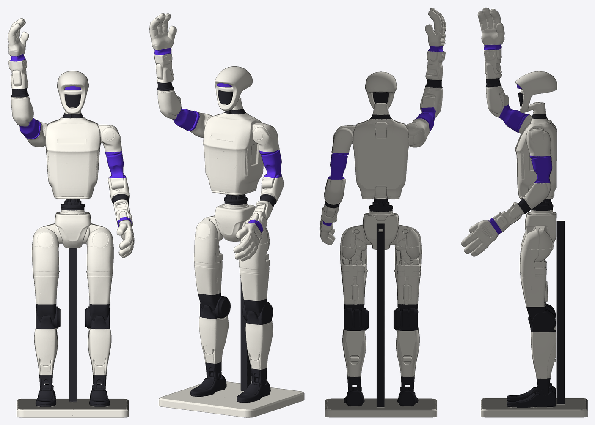
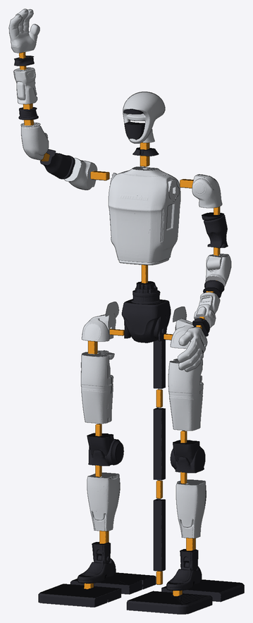

# HUMAN+ · Unitree G1 1:1 全打印静态摆件

把 MakerWorld 的 [Unitree G1 静态模型](https://makerworld.com/models/2512182)（`G1Static.stl`）
等比放大到真机身高，拆成能上机的零件，按 HUMAN+ 配色分件：白色外壳、炭黑关节、紫色点缀。
**纯 3D 打印、不会动**：没有电机、螺丝或金属件，零件之间用打印的方榫条连接。



| | |
|---|---|
| 头顶高度 | 1320 mm（宇树官方站立身高）；举起的右手指尖 1551 mm |
| 宽 × 厚 | 498 × 377 mm（含两臂姿态） |
| 底座 | 440 × 420 × 30 mm，四拼 |
| 文件 / 件数 | 55 个 STL，共 67 件 |
| 粗估耗材 | 白 ≈ 5.7 kg（含底座）· 黑 ≈ 1.0 kg（含支撑柱）· 紫 ≈ 0.2 kg · 连接件 ≈ 0.4 kg（2 层壁 + 12% 填充估算，以切片软件为准） |
| 胸口 logo 位 | 112 × 24 mm 平底浅槽，贴纸建议 108 × 20 mm |
| 重心 | 离底座顶面约 743 mm，落在底座中心，倾倒角约 15° |

> **请先知悉**
> - 文件只做过软件检查（见下方“已校验”），**没有实物试打**。请先打
>   `stl/3_connectors/fit_test_coupon.stl` 试榫条松紧，再开大件。
> - 黑色、紫色件与白色外壳的分界是**按平面切出来的近似边界**（源模型是一整块，没有按零件分块），
>   位置对照模型上的分缝线选定，和真机不完全一致。
> - 脚踝最细处内切半径只有约 10 mm，撑不住约 7 kg 的上身，所以**加了一根背后黑色支撑柱**
>   （底座 → 骨盆后侧）。脚掌和脚踝做成一体，不在最细处拆件。
> - 配色取自 HUMAN+ 效果图的色卡：白 `#ECE9E0`、炭黑 `#2E2E34`、紫 `#5C34D6`。紫色用在上臂段、腕环和面罩上方的灯带；
>   黑色只留在颈、面罩、腰柱、肘环、膝、脚和支撑柱。耗材颜色以实物色卡为准。
> - 源模型是 Standard Digital File License：只能自用，**不能转发文件**，所以本仓库必须保持私有。

## 目录

```
stl/1_white/          白色 21 件：外壳 16 件、骨盆、底座 4 块
stl/2_black/          黑色 12 件：脚 2、膝 2、颈环、腰柱、肘环 2、面罩、支撑柱 3 段
stl/3_purple/         紫色 5 件：上臂段 2、腕环 2、面罩灯带
stl/4_connectors/     榫条 24 根（15 种规格）、底座蝴蝶键 4 个、试配件 1 个
docs/parts.csv        每个文件的尺寸 / 体积 / 数量 / 适用机器 / 用途
docs/summary.json     总体数据与每处榫条规格
docs/preview_*.png    预览图与爆炸图
generator/            生成全部文件的脚本
source/g1/            源模型（zip 切成三段，生成脚本会自动拼接解压）
```

所有 STL 都已摆成**打印姿态**（贴床面朝下、居中），导入切片软件后不要再旋转。

## 机器分工

- **A2L**：只有 `torso.stl`（173 × 231 × 315 mm）必须用它。
- **A1 ×2、X2D**：其余 54 个文件都放得进 256 mm 机器（已留 6 mm 边）。
- 建议：A2L 打躯干和大腿；两台 A1 打白色件；X2D 打黑色、紫色件和连接件。

## 打印建议

| 零件 | 耗材 | 参数 |
|---|---|---|
| 白色外壳、骨盆 | 哑光 PLA 象牙白 | 0.2 mm 层高，2–3 层壁，10–15% 填充；需要支撑的：`head`、`hand_*`、`torso`、`hip_*` |
| 黑色关节件 | 哑光 PLA 炭黑 | 3 层壁，15% 填充 |
| 紫色件 | PLA 紫（接近 `#5C34D6`） | 3 层壁，15% 填充 |
| `waistcol` | 哑光 PLA 炭黑 | 6 层壁，40% 填充（腰柱承上身重量） |
| `foot_L` / `foot_R` | 同上 | **100% 填充**（脚踝最细处） |
| `pelvis` | 哑光 PLA 象牙白 | 侧躺打印，4 层壁，20% 填充 |
| `visor_1`（黑）/ `visor_2`（紫） | 亮面 PLA Basic 或 PETG | 平面朝下 |
| 榫条、蝴蝶键、`post_*` | PETG / PLA Tough | 平躺，4 层壁，40% 填充 |
| 底座 4 块 | 哑光 PLA 象牙白 | 顶面朝上，3 层壁，15% 填充 |

## Logo 贴纸位

- 位置：胸口正中偏上（原模型 UNITREE 浮雕字的位置，已被这块槽盖掉），槽中心离地 1050 mm。
- 形状：112 × 24 mm 圆角矩形平底浅槽，深 0.4–2.5 mm（胸口略有弧度，所以深浅不一），槽底是平面，贴纸能贴平。
- 贴纸建议做 108 × 20 mm，四周各留 2 mm。Logo 本身不打印。

## 连接方式



- **方榫条（图中橙色）**：T24 / T16 两种截面，脚本按每处截面自动选能保证孔周壁厚 ≥ 4 mm
  的最大规格。孔比榫条单边大 0.2 mm；方形截面自带防转。每根榫条用在哪见 `parts.csv` 的备注列。
- **腿、躯干靠重力压实**，榫条不必上胶。**手臂是悬挂件**，肩、袖、肘环、腕的榫条两端都要上胶
  （CA 或环氧）。面罩从正面压进面框后点胶。
- **底座**四块在底面用 4 个蝴蝶键拼合。
- **支撑柱**三段用 T16 榫条接长，底端插底座，顶端用一根横向 T16 榫条从背后穿过柱子插进骨盆。支撑柱是黑色，从正面两腿之间能看到。

## 组装顺序

1. 底座四块翻面，压入蝴蝶键，翻回。
2. 两个脚掌用 T24×26 插到底座上；依次往上装小腿、膝、大腿（榫条都是竖直的）。
3. 左右髋壳用横向 T16×69 插到骨盆两侧，再把这一组整体落到两条大腿上（T24×79）。
4. 支撑柱三段接好插进底座，从背后把横榫穿过柱顶插进骨盆。
5. 腰柱套到骨盆顶上，躯干落到腰柱上（一根 T16×139 穿过三件），放颈环、头（T24×89），压入面罩和灯带，胸口贴 logo。
6. 手臂先各自拼好并上胶：肩 → 袖 → 肘 → 环 → 前臂 → 腕 → 手，胶干后再用 T24×69 横插到躯干两侧并上胶。

## 已校验（软件）

- 源文件 sha256 `5d4c5b31…7d3bd0`，本身是单个封闭实体，直接做布尔运算，没有体素重建。
- 头顶 1320.0 mm；分件体积合计 = 原模型的 99.999%（没有丢块）。
- 每个零件是单一封闭实体，放得进指定机器。
- 装配状态下任意两件（含榫条、底座、支撑柱）相交体积为 0。
- 每个榫孔加厚 2.5 mm 后仍有 99% 以上落在零件内（脚掌前端那两个是 99.3%）；榫孔之间互不相碰。

## 重新生成

```
pip install -r generator/requirements.txt
python3 generator/g1_build.py
```

切面位置、榫条范围、底座和支撑柱尺寸都在 `generator/g1_build.py` 顶部的参数区。
